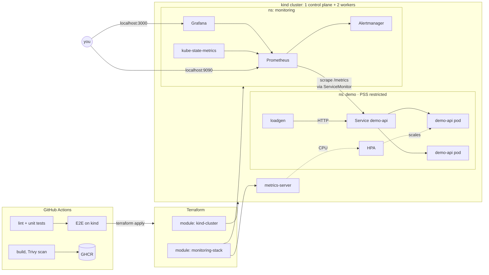
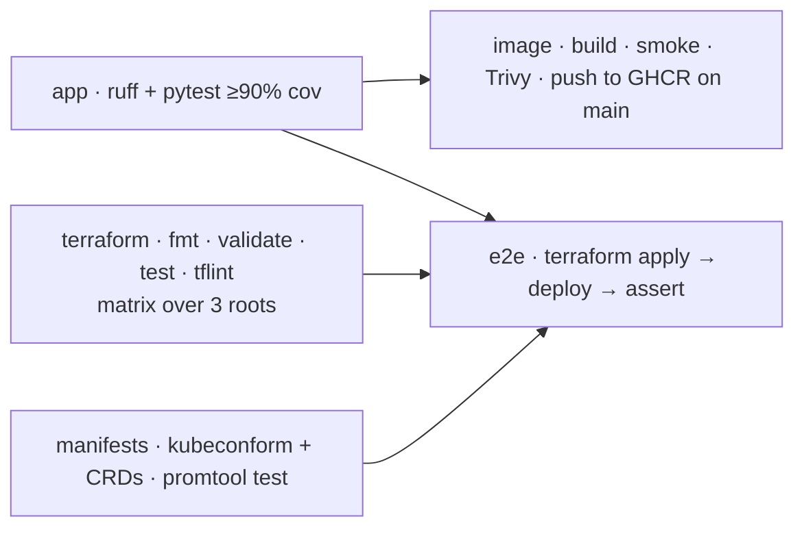

# k8s-observability-lab

[](https://github.com/sergiy22/k8s-observability-lab/actions/workflows/ci.yml)


A production-style Kubernetes platform you can run on a laptop with **one command**.
Terraform provisions a multi-node [kind](https://kind.sigs.k8s.io/) cluster and installs the monitoring stack.
An instrumented service is deployed with hardened manifests, and GitHub Actions tests every layer,
up to a full end-to-end run on a fresh cluster.

> **Why this repo exists:** it shows how I approach platform work: reusable infrastructure as code,
> secure-by-default workloads, observability with tested alerts and runbooks, and CI that proves it all works.

---

## What's inside

| Layer | What | Highlights |
|---|---|---|
| **Infrastructure as Code** | [`terraform/modules/kind-cluster`](terraform/modules/kind-cluster) | Multi-node cluster, pinned node image digest, NodePort to localhost mappings, input validation |
| | [`terraform/modules/monitoring-stack`](terraform/modules/monitoring-stack) | kube-prometheus-stack (Prometheus, Alertmanager, Grafana, node-exporter, kube-state-metrics) + metrics-server via Helm |
| | [`terraform/environments/local`](terraform/environments/local) | Composes both modules; providers are wired from cluster outputs, so a single `apply` goes from zero to running stack |
| **Application** | [`app/`](app) | Python/Flask service with RED metrics (`http_requests_total`, latency histogram, in-flight gauge), tunable error rate and latency for demos |
| **Kubernetes** | [`k8s/`](k8s) | Kustomize base + overlay, Pod Security `restricted`, non-root read-only containers, probes, HPA, PDB, topology spread, default-deny NetworkPolicy |
| **Observability** | [`k8s/base/monitoring.yaml`](k8s/base/monitoring.yaml) | ServiceMonitor, recording rules, 4 alerts with [runbooks](docs/runbooks.md), Grafana dashboard shipped as code |
| **CI/CD** | [`.github/workflows/ci.yml`](.github/workflows/ci.yml) | Lint, unit tests, Terraform tests, schema validation, alert unit tests, image scan, GHCR publish, kind E2E |

## Architecture



## Quick start

**Prerequisites:** Docker, Terraform ≥ 1.7, kind, kubectl, make. About 4 GB of free RAM for Docker.

```bash
git clone https://github.com/sergiy22/k8s-observability-lab.git
cd k8s-observability-lab
make up        # ~5 minutes: cluster → monitoring → image → deploy
```

When it finishes:

| | URL | Credentials |
|---|---|---|
| Grafana | http://localhost:3000 | `admin` / `make urls` |
| Prometheus | http://localhost:9090 | — |
| demo-api | `make app-forward` → http://localhost:8080 | — |

Open **Grafana → Dashboards → demo-api / RED overview**. The in-cluster load generator sends
traffic, so graphs fill up within a minute.

```bash
export KUBECONFIG=$PWD/terraform/environments/local/kubeconfig
make status    # pods, HPA, Prometheus targets
make down      # destroy everything
```

## Demo: break it and watch the alert

```bash
make chaos     # 30% of requests fail, latency rises up to 900 ms
```

1. The **Error ratio** and **Latency p95** panels turn red within a minute.
2. `DemoApiHighErrorRate` goes **pending**, then **firing** after 5 minutes at http://localhost:9090/alerts.
3. Follow the linked [runbook](docs/runbooks.md#demoapihigherrorrate) to diagnose it.

```bash
make calm      # back to normal; the alert resolves
```

## CI pipeline



| Job | What it proves |
|---|---|
| **app** | Code style (ruff), unit tests with a coverage gate |
| **terraform** | Every module is formatted, valid, lint-clean and passes `terraform test` with mocked providers (no cloud or cluster needed) |
| **manifests** | Rendered Kustomize output is valid against Kubernetes 1.36 and Prometheus Operator CRD schemas; alert rules pass `promtool test rules` |
| **image** | Image builds, runs read-only and serves traffic; Trivy reports go to GitHub code scanning; fixable CRITICALs fail the build; published to GHCR from `main` |
| **e2e** | On a fresh kind cluster built by the same Terraform: app rolls out, Prometheus scrapes 2/2 targets, alert rules load, Grafana provisions the dashboard; always torn down |

Supply-chain hygiene: all third-party actions are **pinned to commit SHAs**, workflow permissions
are least-privilege per job, and Dependabot tracks actions, pip, Docker and Terraform providers.

## Design decisions

- **kind instead of a cloud cluster.** Anyone can reproduce it for free in minutes, and CI runs the
  real thing. The `monitoring-stack` module doesn't depend on kind and can target EKS/GKE/AKS
  (set `metrics_server_insecure_tls = false` and leave node ports `null`).
- **Terraform owns the platform, Kustomize owns the app.** Cluster-level, slow-changing components
  live in Terraform state. Application manifests stay plain YAML that a GitOps tool such as Argo CD
  or Flux could sync unchanged.
- **Dashboards and alerts live next to the app.** The ServiceMonitor, PrometheusRule and dashboard
  ConfigMap ship with the workload, so whoever owns the service owns its monitoring.
- **Alerts are tested like code.** `promtool test rules` checks that alerts fire and stay quiet
  exactly when they should, annotations included.
- **Secure by default.** Restricted Pod Security, non-root UID, read-only root FS, all capabilities
  dropped, no service-account token, default-deny ingress. The Grafana password is generated by
  Terraform and passed with `set_sensitive`, so it never appears in plan output or chart values
  (a unit test checks this).
- **Single process per pod.** Gunicorn runs 1 worker with threads, so Prometheus metrics need no
  multiprocess mode. Throughput scales out with replicas and the HPA.

## Repository layout

```
.
├── app/                         # demo-api: Flask + prometheus_client, Dockerfile, tests
├── k8s/
│   ├── base/                    # Deployment, Service, HPA, PDB, NetworkPolicy, ServiceMonitor, rules, dashboard
│   ├── overlays/local/          # image tag for kind + load generator
│   └── tests/                   # promtool unit tests for alerts
├── terraform/
│   ├── modules/kind-cluster/    # reusable module + terraform test
│   ├── modules/monitoring-stack/
│   └── environments/local/      # composition root
├── docs/runbooks.md
├── .github/workflows/ci.yml
└── Makefile                     # `make help` lists everything
```

## Running the checks locally

```bash
make test                 # app tests, terraform test + tflint, promtool alert tests
make validate-manifests   # kustomize | kubeconform (needs kustomize, kubeconform)
```

## Roadmap

- [ ] Loki + Promtail for logs, with log panels linked from the dashboard
- [ ] OpenTelemetry tracing with Tempo
- [ ] Argo CD environment that syncs `k8s/overlays/*`
- [ ] `environments/aws` composing an EKS module with the same `monitoring-stack`
- [ ] SLO burn-rate alerts (multi-window, multi-burn-rate)

## License

[MIT](LICENSE)
